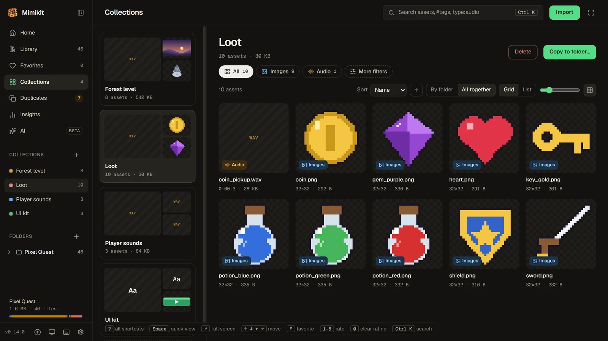

<p align="center">
  
</p>

<h1 align="center">Mimikit</h1>

<p align="center">
  <strong>Every game asset. Seen, sorted, managed.</strong><br>
  A free, open-source asset manager for game developers on Windows, macOS and Linux.
</p>

<p align="center">
  <a href="https://github.com/sanchezrobertodev/mimikit/releases/latest"></a>
  
  <a href="LICENSE"></a>
</p>

<p align="center">
  <a href="https://github.com/sanchezrobertodev/mimikit/releases/latest"><strong>Download</strong></a> ·
  <a href="#features">Features</a> ·
  <a href="#documentation">Docs</a> ·
  <a href="CHANGELOG.md">Changelog</a> ·
  <a href="https://ko-fi.com/sanchezrobertodev">Support</a>
</p>

https://github.com/user-attachments/assets/7a4809b2-1a93-4734-8b14-51a650641fb6


Game assets pile up fast: a sprite pack from one store, sounds from another, models from an old project, a downloads
folder full of copies. Mimikit gathers those folders into one visual library where every file shows up as a thumbnail
you can preview in place. Sort them with tags, ratings and collections, clear out duplicate copies, see what takes the
space, then drag what you need straight into your engine.

It runs on your computer with no account, and it leaves your files where they are: tags, collections and everything
else you add live in Mimikit's own database. Mimikit was called Asset Den until 0.4.0.


## Contents

- [Features](#features)
- [Install](#install)
- [Keyboard shortcuts](#keyboard-shortcuts)
- [Your files are safe](#your-files-are-safe)
- [Documentation](#documentation)
- [Known limits](#known-limits)
- [Development](#development)
- [Translations](#translations)
- [Support](#support) · [License](#license)

## Features

### See everything

- **Every kind of asset in one library**: images and sprite sheets, audio, 3D models, fonts, video, and text or data
  files. Import one or more folders: assets appear while a folder is still scanning, and a live watcher picks up added,
  renamed and deleted files (renames keep their tags). Engine sidecars (`.meta`, `.import`, `.uid`), hidden folders and
  `node_modules` are skipped, plus any folder names you add in **Settings → Library**.
- **Previews in place**, in the side panel (<kbd>Space</kbd>) or full screen (<kbd>Enter</kbd>):
  - images: zoom and pan, pixel-art scaling, transparency checkerboard (PNG, JPG, GIF, WebP, BMP, SVG, and
    TGA/PSD/TIFF/Aseprite via a decoded preview), and **Animate** to play a sprite sheet with a remembered grid and fps
  - audio: waveform and playback, plus play-on-hover in the grid (WAV, OGG, MP3, FLAC, M4A/AAC, Opus, and AIFF via a
    WAV copy)
  - 3D models: orbit, wireframe, triangle counts and the first animation (GLB/glTF, FBX, OBJ, STL), with
    auto-rendered thumbnails. OBJ files load the materials and textures from their `.mtl`. Blender files show the
    preview picture saved in them
  - fonts: a specimen with editable sample text
  - video, with a frame from the video as its grid thumbnail, and text
- **Browse your way**: a grid or list grouped by folder (or all together), type chips, sorting and a thumbnail-size
  slider. **More filters** narrows by extension, image size, file size, date, tags and rating.
- **Folders**: an expandable folder tree with file counts, and a breadcrumb whose carets jump to any subfolder or a
  recent folder. Subfolder chips drill down, <kbd>Alt+↑</kbd> goes to the parent, and **Include subfolders** switches
  between a folder's own files and everything below it.

### Organize

- **Tags, favorites, 1–5 star ratings and notes.** Most changes show a toast with **Undo**.
- **Collections** group assets for a level, a pack or a handoff. Rename one in place, or copy its files into a folder
  for a build. **Save as smart collection** turns the current search and filters into a collection that keeps itself
  up to date. An open collection has the same type chips, search, filters, sort and layouts as the library.
- **Backups**: **Settings → Backups and storage** saves a copy of the library (folders, tags, ratings, notes,
  collections, sprite grids) wherever you like, and restores one. Mimikit also keeps a backup a day, the last 5.
  Restoring saves the current library first, so you can switch back.

### Clean up

- **Duplicates**: identical files side by side. Keep the one you want, then mark the rest as not duplicates or move
  them to the Trash, with tags, favorites, ratings, notes and collections merged into the kept file.
- **Insights**: totals, storage by type, and the largest files and folders. Each row jumps to the matching assets.

### Find

- **Search** (<kbd>Ctrl/⌘ K</kbd> or <kbd>/</kbd>): one box for assets, folders and actions, with `type:audio`,
  `in:sprites`, `#player`, `size:>1mb`, `rating:>=4` (or `rating:3`, `rating:<2`) and `note:redo`. Its first result
  applies the search to the grid.
- **Find similar** and **search by colour**: the side panel finds images that look like the open one (resized,
  recoloured or lightly cropped copies included), and the Colour filter or `color:red` / `color:#ff8800` finds images
  by their main colours. Both need images analysed: the ones you browse are done as you go, **Analyse images** in
  **Settings → Library** does the rest (on spare CPU, with Pause and Cancel), and **Keep new and changed images
  analysed** keeps it current. Results say how many images they cover.
- **Search by meaning** (<kbd>Shift+Enter</kbd> in the search box, or `looks:red-potion-icon`): find images, 3D
  models, videos and fonts by describing them, in any language ("red potion icon", "poción roja"), tagged or not.
  **Find related** in the side panel shows the assets closest in meaning to the open one. Runs on your computer after
  a one-time download, with no account or key. See [Search by meaning](docs/search-by-meaning.md).

### Use it in your engine

- **Drag out**: drag one card or a selection into Unity, Godot, Unreal, Blender or a folder. It always copies. In
  Unity, drop onto the **Project** window: the Hierarchy and Scene view only take assets that are already in the
  project.

### AI (beta)

AI features are optional and off at first. **Settings → General → AI features** turns them on, and the **AI** view
then lists each one with how it stands and the next thing to do.

- **Ask** (<kbd>Ctrl/⌘ Enter</kbd> in the search box): describe what you want in plain words and Claude writes the
  search for you, which you see and can change. See [Ask](docs/ask.md).
- **Suggest tags**: Claude suggests tags for many assets at once, and none become tags until you accept them. See
  [Suggest tags](docs/suggest-tags.md).
- **AI agents**: let any app that speaks MCP, such as Claude Code, Claude Desktop or Cursor, search your library and
  look at your assets ("find a coin sprite and tell me its path"). They only read until you allow changes, and each
  app asks first. See [AI agents](docs/ai-agents.md).

Ask and Suggest tags use your own Anthropic API key. Turning AI off hides them everywhere and turns agents off; your
key, your tags and unreviewed suggestions stay for when you turn it back on. Updating from an earlier version keeps it
on. Search by meaning, which runs on your computer, keeps its own switch.

### Comfortable for everyone

- **Themes**: light, dark, black, midnight, sepia and two high-contrast themes, plus eight accent colours, in
  **Settings → Appearance**. The sidebar footer switches between System, Dark and Light.
- **Languages**: English, Spanish, Brazilian Portuguese, French, German, Japanese and Simplified Chinese. Mimikit
  follows the system language, or pick one in **Settings → General**. See [Translations](#translations).
- **Accessibility**: works from the keyboard alone (focus rings everywhere, dialogs that keep and return focus, a skip
  link to the assets, arrow keys for stars) and with screen readers (named controls, announced toasts and scans). Text
  meets WCAG AA contrast in every theme (AAA in the high-contrast ones), and the system's "reduce motion" setting
  stops anything from playing by itself.
- **Updates**: the app checks for a new version on launch and installs it in place. See [Updates](#updates).

<table>
  <tr>
    <td width="50%"></td>
    <td width="50%"></td>
  </tr>
  <tr>
    <td align="center">The side panel on a 3D model</td>
    <td align="center">Collections</td>
  </tr>
  <tr>
    <td width="50%"></td>
    <td width="50%"></td>
  </tr>
  <tr>
    <td align="center">Duplicates</td>
    <td align="center">Insights</td>
  </tr>
</table>

The screenshots show a small sample library generated for them: procedural sprites, tiles, sounds, models and videos.

## Install

Download the file for your OS from the
[latest release](https://github.com/sanchezrobertodev/mimikit/releases/latest).

| OS | File | Notes |
|---|---|---|
| Windows | `Mimikit_<version>_x64-setup.exe` | Installs per user, without admin rights. The build isn't code-signed, so SmartScreen may warn: choose **More info → Run anyway**. |
| macOS | `Mimikit_<version>_universal.dmg` | Apple Silicon and Intel. Drag the app to Applications. It isn't signed with an Apple Developer ID or notarized, so Gatekeeper blocks the first launch: open **System Settings → Privacy & Security** and choose **Open Anyway** (or run `xattr -dr com.apple.quarantine "/Applications/Mimikit.app"`). Updates installed by the app don't ask again. |
| Linux | `Mimikit_<version>_amd64.AppImage` or `Mimikit_<version>_amd64.deb` | The AppImage runs anywhere (`chmod +x` it first) and updates itself. The `.deb` installs system-wide and doesn't update itself: install the next `.deb` by hand. Install the GStreamer plugins for MP4/H.264 video previews. |

### Updates

Installed copies check for a new version on launch, and whenever you press **Check for updates** in the sidebar footer
or the search palette. A new version shows its notes, and **Install & restart** downloads it, verifies its signature
and relaunches. Windows, macOS and the Linux AppImage update themselves; a `.deb` install doesn't. More in
[Updates](docs/updates.md).

## Keyboard shortcuts

| Keys | What they do |
|---|---|
| <kbd>Ctrl/⌘ K</kbd> or <kbd>/</kbd> | Search |
| <kbd>Ctrl/⌘ Enter</kbd> in the search box | Ask Claude to write the search (AI on) |
| <kbd>Shift+Enter</kbd> in the search box | Search by meaning |
| <kbd>Space</kbd> | Side panel |
| <kbd>Enter</kbd> | Full screen |
| <kbd>←</kbd> <kbd>→</kbd> | Previous / next asset |
| <kbd>Alt+↑</kbd> | Parent folder |
| <kbd>F</kbd> | Favorite |
| <kbd>1</kbd>–<kbd>5</kbd>, <kbd>0</kbd> | Rate, clear the rating |
| <kbd>Shift</kbd>/<kbd>Ctrl</kbd>-click, <kbd>Ctrl+A</kbd> | Select |
| <kbd>Ctrl+Z</kbd> | Undo |
| <kbd>Esc</kbd> | Step back |
| <kbd>?</kbd> | All shortcuts |

## Your files are safe

Tags, favorites, ratings, notes and collections live in the app's own database, and removing a folder from the library
only forgets it. The one exception is on the Duplicates page: when you choose to, Mimikit moves the extra copies of a
file to your system's Trash (restorable there), after asking and after checking that they are still byte-for-byte
identical. "Copy to folder…" only ever creates new files.

<details>
<summary><strong>Where Mimikit keeps its data</strong></summary>

| What | Where |
|---|---|
| Index, tags, favorites, ratings, notes, collections, ignored folder names, image analysis, suggested tags and the batches out with Claude | `asset-den.db` (SQLite) in the app data folder |
| Automatic backups, and the library saved before each restore | `backups/` in the app data folder (**Settings → Backups and storage → Show folder**) |
| Thumbnails, decoded previews and the font samples Suggest tags sends | `thumbs/` and `previews/` in the app cache folder (safe to delete, or **Settings → Clear thumbnail cache**) |
| UI preferences, and the AI agents switch and allowed apps | browser storage in the app's webview |
| Port and token of the AI agents bridge, while it's on | `agent-bridge.json` in the app data folder |
| Search by meaning: the model and ONNX Runtime, downloaded when you turn it on | `models/` in the app data folder (**Settings → Library → Delete model and index**) |
| Search by meaning's index | `meaning.db` (SQLite) in the app data folder. Not in backups: it's rebuilt when needed |

</details>

## Documentation

| Guide | What it covers |
|---|---|
| [Search by meaning](docs/search-by-meaning.md) | Turning it on, what it downloads, searching and narrowing, Find related, `looks:`, speed and privacy |
| [Ask](docs/ask.md) | Your API key, what's sent, the model and effort, the cost per search |
| [Suggest tags](docs/suggest-tags.md) | Right away or as a batch, reviewing suggestions, what's sent, the cost, removing AI tags |
| [AI agents (MCP)](docs/ai-agents.md) | Connecting Claude Code, Claude Desktop, Cursor or VS Code, the tools, what you control, security |
| [Updates](docs/updates.md) | How updates are checked and installed on each platform |
| [Publishing a release](docs/releasing.md) | For maintainers: building, signing and publishing all three platforms |
| [Translations](src/locales/README.md) | The locale file format and the glossary |

## Known limits

- PSD previews use the flattened composite. Some layered or 16-bit files fall back to an icon.
- Aseprite files show their first frame only, and every layer is drawn in Normal mode: layers with other blend modes
  and tilemap layers can look different than in Aseprite.
- Blender files have no 3D view, only the 128×128 preview Blender saves in them. Files saved without one (Blender's
  **File Preview Type** set to None) show a plain card.
- AIFF sounds longer than about 25 minutes (in stereo) don't play.
- FBX textures with absolute paths from another machine won't load.
- Which audio and video formats play, and which videos get a frame thumbnail, depends on the OS webview. Windows
  (WebView2) plays the most; on Linux, install the GStreamer plugins for MP4/H.264.
- A file renamed while the app is closed shows up as a new file on the next scan, so its tags don't follow it.
- Find similar and search by colour only cover analysed images. A full analysis reads every image once (from its
  thumbnail when it has one) and can take several minutes on a big library; scrolling very fast past unanalysed images
  leaves some of them for that pass. Images that change while the app is closed are analysed after the next launch's
  scan only when **Keep new and changed images analysed** is on.
- Search by meaning covers images (PNG, JPEG, GIF's first frame, WebP, BMP, TGA, PSD, TIFF, ICO and Aseprite; not
  SVG), and 3D models, videos and fonts by one picture each (a video by one frame, a font by one line of sample text),
  not sounds or text files, and doesn't read text inside pictures. It doesn't combine with Find similar. Several
  `looks:` words in one search each keep their own best matches, so they rarely overlap: one description works better.
- Search by meaning isn't available on Intel Macs, since Microsoft publishes no ONNX Runtime build for them. On
  Windows it needs Microsoft's Visual C++ runtime; Settings links to it when it's missing.
- Syntax highlighting for text and code is not built yet.

## Development

Building needs Node 22+, Rust stable and the [Tauri prerequisites](https://tauri.app/start/prerequisites/) for your OS.

```bash
npm install
npm run tauri dev
```

To build the installers:

```bash
make install
make build
```

They land in `src-tauri/target/release/bundle/` (`nsis/` or `msi/` on Windows, `dmg/` on macOS, `appimage/`, `deb/`
or `rpm/` on Linux). A build without the signing key can't install updates from the feed.

Run `make check` before every push. It typechecks and bundles the frontend, then runs rustfmt, clippy (warnings are
errors) and the Rust tests. These local checks replace CI on push: the only GitHub workflow is **Release**, started by
hand to publish the macOS and Linux builds. [Publishing a release](docs/releasing.md) has the steps.

- The app icon's artwork lives in `icon/`. After changing it, `make icons` rebuilds `src-tauri/icons`.
- The agent tools are defined in `src/agent/tools.ts` and run in the window (`src/agent/run.ts`); `mimikit mcp`
  (`src-tauri/src/mcp.rs`) lists a copy, `src-tauri/agent-tools.json`, so it can answer while Mimikit is closed.
  `src/agent/tools.test.ts` fails when the copy is out of date; `UPDATE_TOOLS=1 node --experimental-strip-types
  src/agent/tools.test.ts` rewrites it.
- The visual design comes from the "Asset Den UI/UX redesign" project in Claude Design. The tokens live in
  `src/index.css`, and the rationale in `design-system/mimikit/MASTER.md`.

## Translations

The translations were written with AI and checked in the app, not by native speakers, so some wording will be off.
Corrections are welcome: edit the language's files in `src/locales/` and open a pull request.
`src/locales/README.md` explains the format and has the glossary. To add a language, copy `src/locales/en/` to a
new folder named by its language tag; `make check` lists anything missing.

## Support

Mimikit is free and open source. If it saves you time, you can support it on
[Ko-fi](https://ko-fi.com/sanchezrobertodev).

## License

[MIT](LICENSE)
