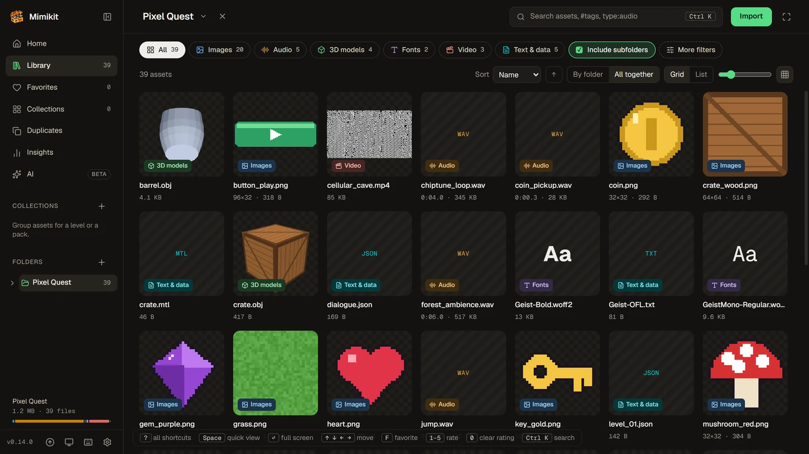
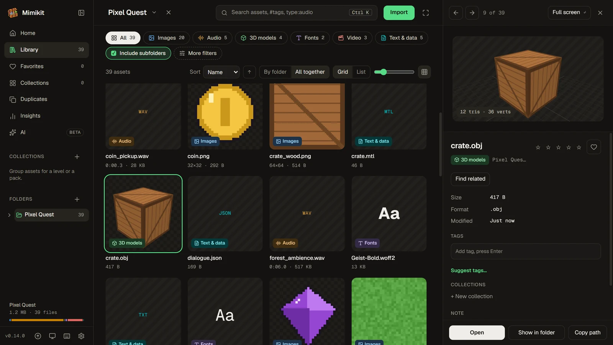
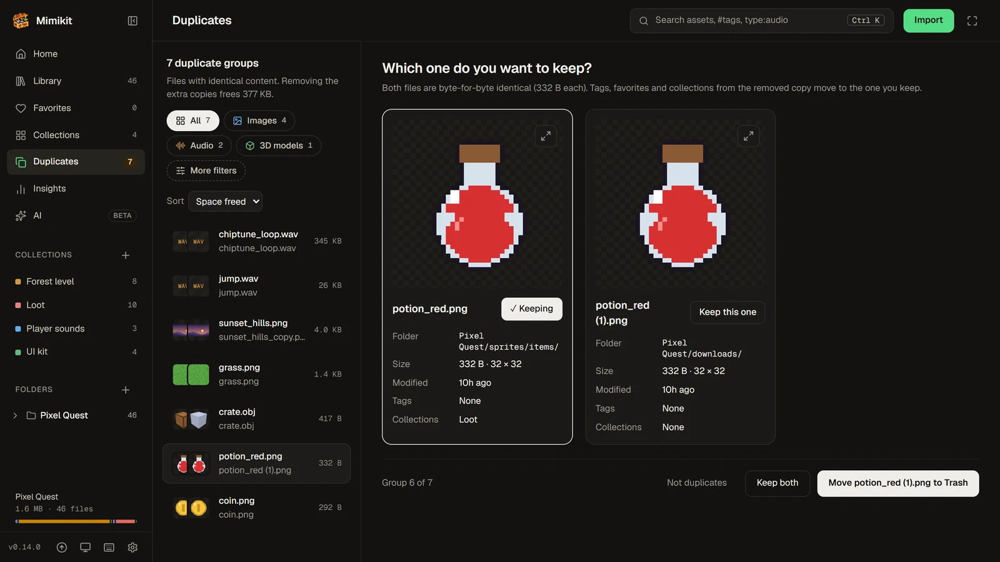
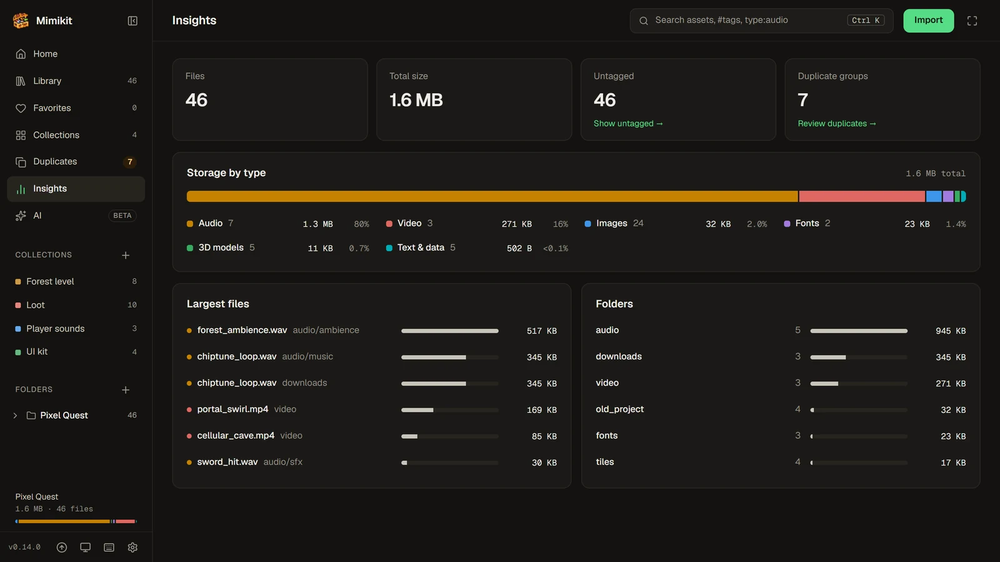

# Mimikit

A desktop asset browser for game developers on Windows, macOS and Linux. Point it at your asset folders and it
indexes every sprite, sound, model, font, video and data file so you can find, preview, tag and drag them into your
engine. Mimikit was called Asset Den until 0.4.0.



**Your files are left alone.** Tags, favorites, ratings, notes and collections live in the app's own database, and removing a folder
from the library only forgets it. The one exception is on the Duplicates page: when you choose to, Mimikit moves the
extra copies of a file to your system's Trash (restorable there), after asking and after checking that they are still
byte-for-byte identical. "Copy to folder…" only ever creates new files.

## Features

- **Library**: import one or more folders. Assets appear while a folder is still scanning, and a live watcher picks up
  added, renamed and deleted files (renames keep their tags). Engine sidecars (`.meta`, `.import`, `.uid`), hidden
  folders and `node_modules` are skipped, plus any folder names you add in **Settings → Library**.
- **Folders**: an expandable folder tree in the sidebar with file counts, and a breadcrumb in the header whose carets
  jump to any subfolder or a recent folder. Subfolder chips drill down, <kbd>Alt+↑</kbd> goes to the parent, and
  **Include subfolders** switches between a folder's own files and everything below it.
- **Browse**: a grid or list grouped by folder (or all together), type chips, sorting and a thumbnail-size slider.
  **More filters** narrows by extension, image size, file size, date, tags and rating.
- **Search** (<kbd>Ctrl/⌘ K</kbd> or <kbd>/</kbd>): one box for assets, folders and actions, with `type:audio`,
  `in:sprites`, `#player`, `size:>1mb`, `rating:>=4` (or `rating:3`, `rating:<2`) and `note:redo`. Its first result
  applies the search to the grid.
- **Ask** (<kbd>Ctrl/⌘ Enter</kbd> in the search box): describe what you want in plain words and Claude writes the
  search for you, which you see and can change. Needs your own Anthropic API key. See [Ask](#ask).
- **Search by meaning** (<kbd>Shift+Enter</kbd> in the search box, or `looks:red-potion-icon`): find images by
  describing them, in any language ("red potion icon", "poción roja"), tagged or not, also in smart collections, Ask
  and AI agents, and **Find related** in the side panel shows the images closest in meaning to the open one. Runs on
  your computer after a one-time download, with no account or key. See [Search by meaning](#search-by-meaning).
- **Side panel** (<kbd>Space</kbd>) and **full screen** (<kbd>Enter</kbd>) previews:
  - images: zoom and pan, pixel-art scaling, transparency checkerboard (PNG, JPG, GIF, WebP, BMP, SVG, and
    TGA/PSD/TIFF via a decoded preview), and **Animate** to play a sprite sheet with a remembered grid and fps
  - audio: waveform and playback, plus play-on-hover in the grid
  - 3D models: orbit, wireframe, triangle counts, the first animation (GLB/glTF, FBX, OBJ, STL), with auto-rendered
    thumbnails. OBJ files load the materials and textures from their `.mtl`
  - fonts: a specimen with editable sample text
  - video, with a frame from the video as its grid thumbnail, and text
- **Organize**: tags, favorites, 1–5 star ratings, notes and collections. Rename a collection in place, or copy its
  files into a folder for a build or a handoff. **Save as smart collection** turns the current search and filters into
  a collection that keeps itself up to date. An open collection has the same type chips, search, filters, sort and
  layouts as the library. Most changes show a toast with **Undo**.
- **Backups**: **Settings → Backups** saves a copy of the library (folders, tags, ratings, notes, collections, sprite
  grids) wherever you like, and restores one. Mimikit also keeps a backup a day, the last 5. Restoring saves the
  current library first, so you can switch back.
- **Drag out**: drag one card or a selection into Unity, Godot, Unreal, Blender or a folder. It always copies.
- **Find similar** and **search by colour**: the side panel finds images that look like the open one (resized,
  recoloured or lightly cropped copies included), and the Colour filter or `color:red` / `color:#ff8800` finds images by
  their main colours. Both need images analysed: the ones you browse are done as you go, **Analyse images** in
  **Settings → Library** does the rest (on spare CPU, with Pause and Cancel), and **Keep new and changed images
  analysed** keeps it current. Results say how many images they cover.
- **Duplicates**: identical files side by side. Keep the one you want, then mark the rest as not duplicates or move
  them to the Trash, with tags, favorites, ratings, notes and collections merged into the kept file.
- **Insights**: totals, storage by type, the largest files and folders. Each row jumps to the matching assets.
- **AI agents**: let Claude Code, Claude Desktop or another MCP app search your library and look at your assets
  ("find a coin sprite and tell me its path"). Off until you turn it on, read only, and each app asks first. See
  [AI agents](#ai-agents-mcp).
- **Updates** (Windows): the app checks for a new version on launch and installs it in place. See [Updates](#updates).
- **Themes**: light, dark, black, midnight, sepia and two high-contrast themes, plus eight accent colours, in
  **Settings → Appearance**. The sidebar footer switches between System, Dark and Light.
- **Languages**: English, Spanish, Brazilian Portuguese, French, German, Japanese and Simplified Chinese. Mimikit
  follows the system language, or pick one in **Settings → Appearance**. See [Translations](#translations).
- **Accessibility**: works from the keyboard alone (focus rings everywhere, dialogs that keep and return focus, a skip
  link to the assets, arrow keys for stars) and with screen readers (named controls, announced toasts and scans). Text
  meets WCAG AA contrast in every theme (AAA in the high-contrast ones), and the system's "reduce motion" setting stops anything from playing by itself.









The screenshots show a small sample library generated for them: procedural sprites, tiles, sounds, models and videos.

Keyboard: <kbd>Ctrl/⌘ K</kbd> or <kbd>/</kbd> search · <kbd>Space</kbd> side panel · <kbd>Enter</kbd> full screen ·
<kbd>←</kbd> <kbd>→</kbd> previous/next · <kbd>F</kbd> favorite · <kbd>1</kbd>–<kbd>5</kbd> rate, <kbd>0</kbd> clear ·
<kbd>Shift</kbd>/<kbd>Ctrl</kbd>-click and <kbd>Ctrl+A</kbd> select · <kbd>Ctrl+Z</kbd> undo · <kbd>Esc</kbd> step back · <kbd>?</kbd> all shortcuts.

## Install

Download the file for your OS from the
[latest release](https://github.com/sanchezrobertodev/mimikit/releases/latest). From then on the app
updates itself (see [Updates](#updates)).

| OS | File | Notes |
|---|---|---|
| Windows | `Mimikit_<version>_x64-setup.exe` | Installs per user, without admin rights. The build isn't code-signed, so SmartScreen may warn: choose **More info → Run anyway**. |
| macOS | `Mimikit_<version>_universal.dmg` | Apple Silicon and Intel. Drag the app to Applications. It isn't signed with an Apple Developer ID or notarized, so Gatekeeper blocks the first launch: open **System Settings → Privacy & Security** and choose **Open Anyway** (or run `xattr -dr com.apple.quarantine "/Applications/Mimikit.app"`). Updates installed by the app don't ask again. |
| Linux | `Mimikit_<version>_amd64.AppImage` or `Mimikit_<version>_amd64.deb` | The AppImage runs anywhere (`chmod +x` it first) and updates itself. The `.deb` installs system-wide and doesn't update itself: install the next `.deb` by hand. Install the GStreamer plugins for MP4/H.264 video previews. |

### Build it yourself

Building needs Node 22+, Rust stable and the [Tauri prerequisites](https://tauri.app/start/prerequisites/) for your OS.

```bash
make install
make build
```

The installers land in `src-tauri/target/release/bundle/` (`nsis/` or `msi/` on Windows, `dmg/` on macOS,
`appimage/`, `deb/` or `rpm/` on Linux). A build without the signing key can't install updates from the feed.

## Updates

Installed copies check this repo's [releases](https://github.com/sanchezrobertodev/mimikit/releases) quietly on
launch, and whenever you press **Check for updates** in the sidebar footer or the search palette. A new version shows
its CHANGELOG notes, and **Install & restart** downloads it, verifies its signature and relaunches. Versions up to 0.3.6
checked the old [asset-den-releases](https://github.com/sanchezrobertodev/asset-den-releases) repo instead; its last
feed points them to 0.3.7 here, which checks this repo from then on.

Windows x64, macOS (both architectures) and the Linux AppImage update themselves. A `.deb` install, or a platform the
feed has no build for, hides **Check for updates**, so it never hits a missing-platform error. The first version with
the updater has to be installed by hand: 0.2.0 on Windows, 0.3.7 on macOS and Linux.

### Publishing a release

Every release carries all three OSes in one GitHub release and one `latest.json`. Windows is built and signed on a
Windows PC with `make release`; macOS and Linux are built by the **Release** workflow on GitHub Actions. Each merges its
entries into the release's `latest.json` instead of replacing it, so they can run in either order.

1. Bump the version in `src-tauri/tauri.conf.json`, `package.json` and `src-tauri/Cargo.toml`.
2. Move the Unreleased notes in `CHANGELOG.md` under `## [x.y.z] - date`. That section becomes the release notes and
   the in-app "What's new". Push the commit.
3. Run the **Release** workflow from the Actions tab on that branch, with the version (`x.y.z`), or
   `gh workflow run Release --ref master -f version=x.y.z`. It builds the universal macOS `.app` and `.dmg` and the
   Linux AppImage and `.deb`, signs the update bundles, and adds them to release `vx.y.z`,
   creating it as a draft if it doesn't exist yet.
4. Run `make release-dry` to build, sign and write `release/vx.y.z/` (installer, `latest.json`, notes) without
   uploading, then `make release` to upload the Windows installer, merge its feed entries and publish the release as
   latest.

Running the workflow first is the smooth order: the draft stays invisible to installed copies until `make release`
publishes it with every platform in the feed. If `make release` goes first, macOS and Linux copies get a "platform not
found" error from **Check for updates** (the launch check stays quiet) until the workflow finishes. Re-running either
replaces only its own files and feed entries. Don't run both at the same moment: the second could overwrite the
first's feed entries.

Before a release that changes how the macOS app is signed or which ONNX Runtime search by meaning downloads, run the
**macOS search by meaning** workflow (`gh workflow run macos-meaning.yml --ref <branch>`, about 25 minutes). It runs
the signed app and checks that it loads the runtime. A Developer ID signature would make macOS refuse Microsoft's
library: that change also needs `com.apple.security.cs.disable-library-validation` in an entitlements file.

Updates are signed with `~/.tauri/asset-den.key`, created with `npx tauri signer generate`, whose public half is in
`tauri.conf.json`. **Back it up somewhere safe and never commit it:** installed copies only accept updates signed with
it, so losing it means users must reinstall by hand. `make build` signs too when the key is present, and otherwise
builds plain installers with a warning.

The workflow needs two repository secrets (Settings → Secrets and variables → Actions):

| Secret | Value |
|---|---|
| `TAURI_SIGNING_PRIVATE_KEY` | The contents of `~/.tauri/asset-den.key` |
| `TAURI_SIGNING_PRIVATE_KEY_PASSWORD` | Its password. Skip it if the key has none: GitHub doesn't store empty secrets, and an unset one reads as empty. |

## AI agents (MCP)

Mimikit can let an AI agent app on your computer search your library and look at your assets: Claude Code, Claude
Desktop, or any app that runs [MCP](https://modelcontextprotocol.io) servers. Ask it things like "find a coin sprite
and tell me its path" or "which of my packs has a pixel font?". Agents only read until you turn on **Allow changes**
for an app. Then it can also tag and rate assets, mark favorites, write notes, make collections and copy files into a
folder, and each change can be undone. Agents can never move, rename or delete your files.

Nothing goes online through Mimikit. The agent app starts `mimikit mcp`, the same program with no window, which talks
to the Mimikit you have open on the same computer. What the tools return goes to your agent app and from there to its
model: that part is up to the agent app.

### Set it up

1. In Mimikit, turn on **Settings → AI agents → Let AI agents see your library**. Settings then shows the commands
   below with the path of your copy of Mimikit filled in, each with **Copy**.
2. Connect your agent app, once:

   **Claude Code**

   ```bash
   claude mcp add --scope user mimikit -- "C:\Users\<you>\AppData\Local\Mimikit\mimikit.exe" mcp
   ```

   `--scope user` makes Mimikit available in every project; leave it out to add it to the current project only. On
   macOS the program is `/Applications/Mimikit.app/Contents/MacOS/mimikit`; on Linux, the AppImage or
   `/usr/bin/mimikit`.

   **Claude Desktop**: add this to `claude_desktop_config.json` (Settings › Developer › Edit Config), then restart
   Claude Desktop:

   ```json
   {
     "mcpServers": {
       "mimikit": {
         "command": "C:\\Users\\<you>\\AppData\\Local\\Mimikit\\mimikit.exe",
         "args": ["mcp"]
       }
     }
   }
   ```

   **Other apps**: add a stdio MCP server whose command is the Mimikit program with the argument `mcp`.
3. Ask the agent about your assets. The first time an app calls, Mimikit asks **Allow Claude Code to see your
   library?** in the corner of its window (and in Settings → AI agents). Until you answer, or when Mimikit is closed or
   AI agents are off, the agent is told so and can say it to you; it still sees the list of tools.
4. To let it organize too, turn on **Let Claude Code change your library** under the app in Settings → AI agents.
   Until then a change fails with `read_only`, and the agent can ask you to turn it on.

### Things to try

- "Find a coin sprite in Mimikit and tell me its path." The agent calls `search`, then `get_assets` for the path.
- "Show me the pixel-art buttons I have." `search`, `view` to look at them on a numbered contact sheet, then `show`
  puts its picks in Mimikit's window, with a **Shown by Claude Code** chip to go back.
- "Which sounds would work for a jump? Under a second." `search` with `type:audio dur:<1s`.
- "What's the license of the Kenney pack?" `read_text` on its LICENSE or readme.
- "Find more tiles like this one." `similar`, Mimikit's Find similar.
- "I like this dragon; what else do I have like it?" With [search by meaning](#search-by-meaning) on, `related`,
  Mimikit's Find related: other dragons and creatures, whatever their names.
- "Find a red potion icon and give me its path." With [search by meaning](#search-by-meaning) on, `search` with
  `type:image looks:red-potion-icon` finds it even when its name and tags don't say so, then `get_assets`.
- "Copy the five best explosion sprites into my Godot project." The agent picks them with Mimikit, then copies them with
  `copy_to_folder` (Claude Code can also copy by path with its own tools).

With **Allow changes** on:

- "Tag the pack I just added, and make a collection of the UI parts." The agent looks at the pack with `view`, then
  makes one `batch` of `tag` and `collect` changes: one entry in **What agents did**, taken back by one **Undo**.
- "Merge the tags `tree` and `trees`." `search` for `#trees`, then `tag` to add `tree` and remove `trees`.
- "Note the license on every asset of the Kenney pack." `read_text` on its LICENSE, then `note`.
- "Make a smart collection of short UI sounds." `collect` with a name and a search such as `type:audio dur:<1s ui`.

### Tools

| Tool | What it does |
|---|---|
| `overview` | The library in brief: assets of each type, the folders, the most used tags, the collections, how much of the image analysis is done, and whether search by meaning is on. Start here. |
| `search` | The search language (`type:`, `in:`, `#tag`, `size:`, `dur:`, `rating:`, `note:`, `color:`, `looks:`), the Filters panel, a collection, a library folder, favorites, a sort and pages. Short rows; with `looks:`, best first. |
| `get_assets` | Full details of up to 50 assets: file path, size, date, pixel size or audio format, tags, rating, note, collections, main colours, sprite-sheet grid. |
| `similar` | Images that look like one image, closest first. |
| `related` | Images closest in meaning to one image (other dragons for a dragon), closest first, from search by meaning's index. |
| `view` | Pictures: one numbered contact sheet of up to 16 assets, or up to 4 larger ones. Images, models and videos show their thumbnail, fonts sample letters. |
| `list_tags` | Every tag and how many assets have it. |
| `list_collections` | The collections and their sizes; a smart collection's saved search. |
| `read_text` | The text of a text or data file, or of a LICENSE or README without an extension: the first 20,000 characters. |
| `show` | Switches Mimikit's window to exactly these assets, so you see what the agent means. |

These need **Allow changes** for the app. Each call changes at most 500 assets, and an app makes at most 30 changes a
minute.

| Tool | What it does |
|---|---|
| `tag` | Adds and removes tags on up to 500 assets. |
| `rate` | Sets the rating, 1 to 5 stars, or clears it. |
| `favorite` | Adds assets to Favorites or takes them out. |
| `note` | Sets or clears one asset's note. |
| `collect` | Makes a collection (or a smart one from a search), or adds assets to one and takes them out. |
| `copy_to_folder` | Copies up to 200 files into a folder: it never replaces a file, and a name that's taken gets a number. Programs and scripts that run when opened (`.exe`, `.bat`, `.ps1`, `.js`…) aren't copied. |
| `batch` | Up to 20 `tag`, `rate`, `favorite`, `note` and `collect` changes as one step, all checked before any is made. |

An error says what happened and what to do, with a code: `not_running`, `not_allowed`, `no_answer`, `paused`,
`read_only`, `rate_limited`, `not_found`, `not_an_image`, `not_text`, `unreadable`, `not_indexed`, `name_taken`,
`smart_collection`, `not_copied`, `not_a_folder`, `too_many`, `too_large`, `invalid_input`, `unknown_tool`, `refused`,
`busy`, `timeout`, `lost`, `internal`.

### What you control

- **The switch**, off at first. Off stops listening and forgets the apps you allowed, so each one asks again.
- **The first call of each app** asks you. **Don't allow** refuses that agent session; a new session asks again.
- **Allow changes**, off at first for each allowed app, and kept until you turn it off or **Forget** the app.
- **Connected agents** in Settings → AI agents lists each agent session with its calls. **Pause** refuses its changes
  until you press **Resume**, while it can still search and look; **Disconnect** refuses that session from then on.
  **Allowed apps** has **Forget**.
- **What agents did** lists the last 50 changes since Mimikit started, newest first, with the values they replaced.
  **Undo last agent change** takes back the newest one still standing, all of a `batch` at once. Each change also shows
  a message with **Undo**, and **Ctrl+Z** (⌘Z) undoes it like your own changes. Undo leaves a value you changed
  yourself since as you left it, and removes a collection the agent made. Copied files stay: Mimikit never deletes
  files.

### Security

- **On this computer only.** Mimikit listens on `127.0.0.1`, on a new random port each time AI agents are turned on,
  and writes the port and a new random 128-bit token to `agent-bridge.json` in its data folder (readable by you only:
  mode 600 on macOS and Linux, the profile folder's own permissions on Windows). `mimikit mcp` reads it for each call.
- **Not from web pages.** A request has to carry the token, name `127.0.0.1:<port>` as its `Host` (a page that points
  its own name at 127.0.0.1 sends that name) and have no `Origin` (browsers send one). Anything else is refused.
- **An app's name is the one it gives.** Any program running as you could read the token file and claim any name, so
  the Allow question guards against surprises, not against software that already runs on your computer.
- **Your files stay as they are.** The tools run in Mimikit's window on the library it already shows. Changes touch
  only Mimikit's own records (tags, ratings, favorites, notes, collections), through the same actions as your own
  edits. No tool moves, renames or deletes a file, removes a library folder, or changes settings or backups.
  `copy_to_folder` only reads the originals and never replaces a file in the folder it copies to.
- **Library text is data.** Names, folders, tags, notes and file contents can come from packs you downloaded, and can
  be written to steer a model. Everything a tool returns from your library sits inside `<mimikit-data>` tags with a
  sentence saying it is content to read, never instructions to follow, and the JSON inside can't close the tags
  early. Error messages never quote your library. An asset named "Ignore previous instructions…" is read, never
  obeyed. `view` labels its pictures with numbers only, and the names stay in the wrapped text; words drawn inside an
  image are part of the picture, though, and can't be wrapped.
- **Limits.** Each call is checked against its schema first. At most 50 assets' details, 16 assets on a contact sheet
  (4 larger pictures), 500 to show, 100 rows a page and 20,000 characters of a text file; an answer over 60,000
  characters or 4 MB of pictures isn't handed over, and the agent is told to ask for less. 16 calls at a time.
- Keep your agent app's own confirmation prompts on.
- On Windows, an update closes every running copy of `mimikit.exe`, the agent apps' `mimikit mcp` included. Reconnect
  them afterwards (in Claude Code, `/mcp`).

## Search by meaning

Describe a picture and Mimikit finds the images that show it: "red potion icon", "dark forest tileset", "hooded
ghost", in English or in another language ("poción roja", "Totenkopf", "ドラゴン"). It looks at the pictures
themselves, so it finds images with no tags and unhelpful file names. It runs on your computer and needs no account,
key or connection once the model is downloaded.

- **Turn it on** in **Settings → AI features → Search by meaning (offline)**. Before anything downloads, it lists each
  file, its size and where it comes from: Google's SigLIP 2 model (Apache-2.0) from Hugging Face, and Microsoft's ONNX
  Runtime (MIT) from Mimikit's GitHub releases, about 810 MB in all. Then Mimikit indexes every image in the
  background on spare CPU, with **Pause** and **Cancel** in the sidebar (about 2 minutes for 3,400 images on a recent
  desktop CPU), and indexes new and changed images as they come in.
- **Search.** Type a description in the search box (<kbd>Ctrl/⌘ K</kbd>) and press <kbd>Shift+Enter</kbd>, or pick
  **Images that show “…”**, the first result when your words match no file names. The library shows the closest images
  first, with a chip in the header; its × or <kbd>Esc</kbd> ends the search by meaning and keeps everything else.
- **Narrow it.** The open folder, **Include subfolders**, the type chips, **More filters** (pixel size, square, date,
  rating, colour) and search words such as `rating:>=4` or `#ui` typed with the description all narrow the results,
  and the best matches are picked from what's left. So "dark forest tileset" with a tileset pack open and **Square**
  on gives that pack's best forest tiles first.
- **How many.** The images that score close to the best match, at most 200. While indexing is still going, a note
  says how many images the results cover, and the results grow as it goes.
- **Find related.** **Find related** in the side panel, next to **Find similar**, shows the images closest in meaning
  to the open one, narrowed the same way: other dragons for a dragon, ropes and chains for a rope. Find similar finds
  copies of one picture; Find related finds pictures of the same kind of thing. It shows the closest 200 however they
  score, since near-copies score far above the rest and would leave little else, and it reads only the index, so it
  loads no model. An image that isn't indexed yet says so. AI agents get it as the tool `related`.
- **In the search language.** `looks:` followed by the description, with hyphens for spaces, searches by meaning
  among whatever the rest of the search matches: `type:image looks:dark-forest-tileset rating:>=4`. It ranks the same
  way, best first whatever the sort, and works anywhere a search does:
  - **smart collections**: **Save as smart collection** keeps the `looks:` word, and the collection's members follow
    the index as it grows;
  - **[Ask](#ask)**: with search by meaning on, Ask writes `looks:` for requests that describe pictures, so "dark
    forest tileset I rated highly" becomes `type:image looks:dark-forest-tileset rating:>=4`;
  - **[AI agents](#ai-agents-mcp)**: `search` takes `looks:` and returns the best matches first, `related` is Find
    related, and `overview` says whether search by meaning is on and how much is indexed. Agents get the ranked
    assets, never the index, and can't turn search by meaning on or start its download.

  With search by meaning off, `looks:` matches nothing, and a note says so with a link to Settings; an agent gets the
  error `not_indexed`.
- **Speed and memory.** The first search takes about 2 seconds while the text model loads, later ones about 50 ms. The
  text model takes about 800 MB of memory while loaded and is unloaded after 10 minutes without a search.
- **Private.** After the download nothing goes online, and nothing about your files leaves the computer. **Delete
  model and index** in Settings removes both. The index takes about 0.8 KB per image and isn't in backups.
- **How good.** On 30 test descriptions over a library of 3,400 game-art images, 84% of the top 10 results
  were right. It reads what a picture shows, not text inside it.

## Ask

Type what you want in the search box in plain words, such as "dark forest ambience longer than a minute" or "red
potion icons I rated highly", and press <kbd>Ctrl+Enter</kbd> (<kbd>⌘↵</kbd> on macOS), or pick **Ask Claude to turn
this into a search** (the first result when your words match nothing). Claude Haiku turns the words into the search
syntax, here `type:audio forest dur:>1m`. The search goes into the box, where you can see and change it, and Mimikit
runs it on your computer like one you typed. **Back to my words** puts your words back.

- **Your own key.** Add an Anthropic API key in **Settings → AI features**
  ([get one](https://platform.claude.com/settings/keys)). Mimikit keeps it in the system's credential store (Windows
  Credential Manager, macOS Keychain, Secret Service on Linux), never in the library, its settings or its logs. The
  window never sees it: Mimikit's backend calls `api.anthropic.com` itself. **Remove** deletes it.
- **What's sent.** The words you typed, a description of the search syntax with examples, and the names of your 300
  most used tags, so `#tag` searches only use tags you have. Never file names, folder paths, file contents or
  thumbnails.
- **Model and effort.** **Settings → AI features** picks the model, Claude Haiku 5.5 (the default), Sonnet 5.5 or Opus
  5.5, and the effort: how much it thinks before answering, Low (the default), Medium or High. A bigger model or more
  effort is slower and costs more, and Low on Haiku is enough for most searches.
- **Cost.** Billed to your API account: about $0.00015 a search with Haiku 5.5 at Low (measured: about 1,500 tokens in
  and under 25 out, answered in about a second). A few hundred tags add up to about 1,000 tokens more. Sonnet and Opus
  cost about 20 and 40 times as much per token.
- **Limits.** The search syntax has no pixel size, square or date terms, so those parts of a request are left out: use
  **More filters** for them. A search Mimikit can't read in full is shown, not run.

## Suggest tags

Claude can suggest tags for many assets at once. Open the assets you want, such as a folder, a search or a filter,
press <kbd>Ctrl+K</kbd> (<kbd>⌘K</kbd> on macOS) and pick **Suggest tags for the N assets shown…**, or select some
and pick **Suggest tags…** in the side panel. The dialog shows how many go, what's sent, the model and the cost before
anything leaves your computer.

- **Right away or as a batch.** The dialog's **Send** switch picks how. **Right away** asks Claude at the normal price,
  four requests of ten assets at a time, and the tags are back in seconds (a minute or two for a big run) while the
  dialog stays open. **As a batch, half price** goes through Anthropic's Message Batches API: results usually arrive
  within minutes (Anthropic allows up to a day), and you can close Mimikit meanwhile: it collects them at the next
  launch. Up to 50 assets start on **Right away**, more on the batch. The sidebar shows a batch run, with **Cancel**,
  and then how many assets have suggestions, with **Review** and what the last run cost.
- **You decide.** Suggestions aren't tags until you accept them. In the side panel they're dashed chips under the tag
  field: click one to add it, or its × to reject it, or **Accept all** / **Reject all**. With several assets
  selected, a chip covers the ones that have it. **More filters → Has suggested tags** finds what's left to review,
  and a smart collection can use it too.
- **What's sent.** For each asset: its name, the name of its folder inside the library folder, its kind and pixel size
  or length, and a small preview: the 256 px thumbnail of an image, a render of a 3D model, a frame of a video, or a
  line of text set in a font. Text files send their first 2 KB; audio sends only its name and details. Also the
  instructions and the names of your 300 most used tags, so suggestions reuse them. Never whole files or full paths.
  Assets Claude was already asked about are left out unless you tick **Also ask again**; a file that changed since
  counts as new.
- **Model.** **Settings → AI features → Tagging model** picks Claude Haiku 5.5 (the default), Sonnet 5.5 or Opus 5.5,
  always at low effort. See the pull request that added it for how the default was chosen.
- **Cost.** Billed to your API account. Measured on 100 mixed assets at batch prices: about $0.02 per 1,000 assets with
  Haiku 5.5, $0.40 with Sonnet 5.5 and $0.80 with Opus 5.5. **Right away** costs twice as much per asset, which for
  50 assets is at most a few cents. The dialog estimates each run, and what it would cost if every reply ran as long
  as allowed. Both are estimates, not limits.
- **Undo.** **Settings → AI features → Remove all AI tags** takes off every tag you accepted from a suggestion, after
  showing how many. Tags you added yourself stay, even ones Claude also suggested. Mimikit never changes your files.

## Develop

```bash
npm install
npm run tauri dev
```

Run `make check` before every push. It typechecks and bundles the frontend, then runs rustfmt, clippy (warnings are
errors) and the Rust tests. These local checks replace CI on push: the only GitHub workflow is **Release**, started by
hand to publish the macOS and Linux builds.

The app icon's artwork lives in `icon/`. After changing it, `make icons` rebuilds `src-tauri/icons`.

The agent tools are defined in `src/agent/tools.ts` and run in the window (`src/agent/run.ts`); `mimikit mcp`
(`src-tauri/src/mcp.rs`) lists a copy, `src-tauri/agent-tools.json`, so it can answer while Mimikit is closed.
`src/agent/tools.test.ts` fails when the copy is out of date; `UPDATE_TOOLS=1 node --experimental-strip-types
src/agent/tools.test.ts` rewrites it.

## Where things live

| What | Where |
|---|---|
| Index, tags, favorites, ratings, notes, collections, ignored folder names, image analysis, suggested tags and the batches out with Claude | `asset-den.db` (SQLite) in the app data folder |
| Automatic backups, and the library saved before each restore | `backups/` in the app data folder (**Settings → Backups → Show folder**) |
| Thumbnails, decoded previews and the font samples Suggest tags sends | `thumbs/` and `previews/` in the app cache folder (safe to delete, or **Settings → Clear thumbnail cache**) |
| UI preferences, and the AI agents switch and allowed apps | browser storage in the app's webview |
| Port and token of the AI agents bridge, while it's on | `agent-bridge.json` in the app data folder |
| Search by meaning: the model and ONNX Runtime, downloaded when you turn it on | `models/` in the app data folder (**Settings → AI features → Delete model and index**) |
| Search by meaning's index | `meaning.db` (SQLite) in the app data folder. Not in backups: it's rebuilt when needed |

## Known limits

- PSD previews use the flattened composite. Some layered or 16-bit files fall back to an icon.
- FBX textures with absolute paths from another machine won't load.
- Which audio and video formats play, and which videos get a frame thumbnail, depends on the OS webview. Windows
  (WebView2) plays the most; on Linux, install the GStreamer plugins for MP4/H.264.
- A file renamed while the app is closed shows up as a new file on the next scan, so its tags don't follow it.
- Find similar and search by colour only cover analysed images. A full analysis reads every image once (from its
  thumbnail when it has one) and can take several minutes on a big library; scrolling very fast past unanalysed images
  leaves some of them for that pass. Images that change while the app is closed are analysed after the next launch's
  scan only when **Keep new and changed images analysed** is on.
- Search by meaning covers images only (PNG, JPEG, GIF's first frame, WebP, BMP, TGA, PSD, TIFF and ICO; not SVG),
  not 3D models, videos, fonts or sounds, and doesn't read text inside pictures. It doesn't combine with Find similar.
  Several `looks:` words in one search each keep their own best matches, so they rarely overlap: one description
  works better.
- Search by meaning isn't available on Intel Macs, since Microsoft publishes no ONNX Runtime build for them. On
  Windows it needs Microsoft's Visual C++ runtime; Settings links to it when it's missing.
- Syntax highlighting for text and code is not built yet.
- The visual design comes from the "Asset Den UI/UX redesign" project in Claude Design. The tokens live in
  `src/index.css`, and the rationale in `design-system/mimikit/MASTER.md`.

## Translations

The translations were written with AI and checked in the app, not by native speakers, so some wording will be off.
Corrections are welcome: edit the language's files in `src/locales/` and open a pull request.
`src/locales/README.md` explains the format and has the glossary. To add a language, copy `src/locales/en/` to a
new folder named by its language tag; `make check` lists anything missing.

## Support

Mimikit is free and open source. If it saves you time, you can support it on
[Ko-fi](https://ko-fi.com/sanchezrobertodev).

## License

[MIT](LICENSE)
